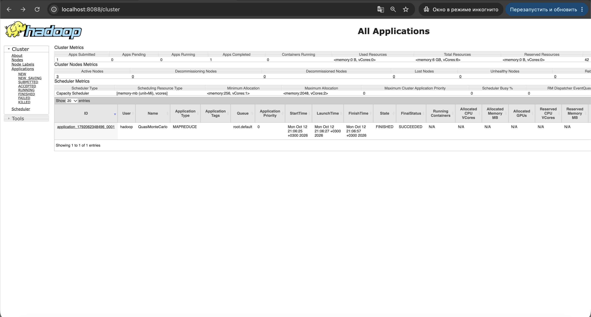

# YARN и публикация веб-интерфейсов кластера

Hadoop 3.4.3, OpenJDK 11. HDFS разворачивается так же, как в `hw-1`, поверх него YARN и MapReduce JobHistory Server.
Веб-интерфейсы всех демонов публикуются наружу через nginx на edge-ноде с парольной защитой.

Скрипты запускаются с edge-ноды `team-17-en`.

| Узел | Сервисы |
| --- | --- |
| `team-17-en` | nginx: публикация веб-интерфейсов |
| `team-17-nn` | NameNode, DataNode, NodeManager |
| `team-17-00` | Secondary NameNode, DataNode, NodeManager |
| `team-17-01` | ResourceManager, JobHistory Server, DataNode, NodeManager |

Хосты, роли, порты и ресурсы задаются в `config/cluster.env`.

## Автоматическое развёртывание

```bash
ssh team@178.236.27.243
git clone https://github.com/lavand0/data_platforms_homework.git
cd data_platforms_homework/hw-2
./deploy.sh
```

`deploy.sh` по очереди запускает:

1. `scripts/00`–`05` — разворачивают и проверяют HDFS. Конфиги генерируются из всех шаблонов в `config/templates/`, включая `yarn-site.xml` и `mapred-site.xml`;
2. `scripts/06-start-yarn.sh` — создаёт каталоги YARN в HDFS, запускает ResourceManager, NodeManager на всех узлах и JobHistory Server;
3. `scripts/07-publish-web.sh` — ставит nginx на edge-ноду, создаёт логин и пароль, публикует веб-интерфейсы;
4. `scripts/08-check-yarn.sh` — проверяет YARN и веб-интерфейсы.

Пароль генерируется при первом запуске, выводится в конце `07-publish-web.sh` и хранится в `~/.hadoop-web-credentials` на edge-ноде.

```bash
./scripts/stop-yarn.sh          # остановить YARN
./scripts/stop-cluster.sh       # остановить HDFS
./scripts/destroy-cluster.sh    # остановить всё и стереть данные
```

## Веб-интерфейсы

Логин `admin`, пароль из `~/.hadoop-web-credentials`.

| Демон | Внешний адрес | Внутренний адрес |
| --- | --- | --- |
| NameNode | <http://178.236.27.243:9870> | `team-17-nn:9870` |
| Secondary NameNode | <http://178.236.27.243:9868> | `team-17-00:9868` |
| DataNode (`team-17-nn`, `-00`, `-01`) | <http://178.236.27.243:9864>, `:9865`, `:9866` | `<узел>:9864` |
| ResourceManager | <http://178.236.27.243:8088> | `team-17-01:8088` |
| NodeManager (`team-17-nn`, `-00`, `-01`) | <http://178.236.27.243:8042>, `:8043`, `:8044` | `<узел>:8042` |
| JobHistory Server | <http://178.236.27.243:19888> | `team-17-01:19888` |

Те же адреса можно открыть через туннель на `localhost`:

```bash
ssh -N $(for p in 9870 9868 9864 9865 9866 8088 8042 8043 8044 19888; do echo -L ${p}:localhost:${p}; done) team@178.236.27.243
```

## Ручное развёртывание

**1. HDFS** — шаги 1–4 из `hw-1/README.md`. Дополнительно на всех узлах: `mkdir -p /data/hadoop/yarn/{local,logs}` и `chown -R hadoop:hadoop /data/hadoop/yarn`.

**2. Конфигурация YARN — на всех узлах**, в `/opt/hadoop/etc/hadoop/`. Готовые шаблоны лежат в `config/templates/`.

| Файл | Параметр | Значение |
| --- | --- | --- |
| `yarn-site.xml` | `yarn.resourcemanager.hostname` | `team-17-01` |
| | `yarn.resourcemanager.bind-host`, `yarn.nodemanager.bind-host` | `0.0.0.0` |
| | `yarn.nodemanager.aux-services` | `mapreduce_shuffle` |
| | `yarn.nodemanager.local-dirs` / `log-dirs` | `/data/hadoop/yarn/local` / `/data/hadoop/yarn/logs` |
| | `yarn.nodemanager.resource.memory-mb` | `2048` |
| | `yarn.nodemanager.vmem-check-enabled` | `false` |
| | `yarn.log-aggregation-enable` | `true` |
| | `yarn.log.server.url` | `http://team-17-01:19888/jobhistory/logs` |
| `mapred-site.xml` | `mapreduce.framework.name` | `yarn` |
| | `mapreduce.jobhistory.address` | `team-17-01:10020` |
| | `mapreduce.jobhistory.webapp.address` | `team-17-01:19888` |
| | `yarn.app.mapreduce.am.env`, `mapreduce.{map,reduce}.env` | `HADOOP_MAPRED_HOME=/opt/hadoop` |
| | `*.memory.mb` / `*.java.opts` для AM, map, reduce | `512` / `-Xmx400m` |

**3. Запуск YARN**

```bash
# team-17-nn: каталоги в HDFS
sudo -u hadoop /opt/hadoop/bin/hdfs dfs -mkdir -p /tmp/logs /user/hadoop
sudo -u hadoop /opt/hadoop/bin/hdfs dfs -chmod 1777 /tmp /tmp/logs

# team-17-01
sudo -u hadoop /opt/hadoop/bin/yarn --daemon start resourcemanager

# team-17-nn, team-17-00, team-17-01
sudo -u hadoop /opt/hadoop/bin/yarn --daemon start nodemanager

# team-17-01
sudo -u hadoop /opt/hadoop/bin/mapred --daemon start historyserver
```

**4. Публикация веб-интерфейсов — на edge-ноде**

```bash
apt-get install -y nginx
printf 'admin:%s\n' "$(openssl passwd -apr1 '<пароль>')" > /etc/nginx/hadoop.htpasswd
```

В `/etc/nginx/conf.d/hadoop-ui.conf` — по блоку `server` на каждый интерфейс из таблицы выше, например:

```nginx
server {
    listen 8088;
    auth_basic "Hadoop ResourceManager";
    auth_basic_user_file /etc/nginx/hadoop.htpasswd;
    location / {
        proxy_pass http://team-17-01:8088;
        proxy_set_header Host $http_host;
    }
}
```

```bash
nginx -t && systemctl restart nginx
```

## Проверка

```bash
./scripts/08-check-yarn.sh
```

Скрипт проверяет:
- демоны ResourceManager, 3 NodeManager и JobHistory Server;
- 3 NodeManager в состоянии RUNNING;
- выполнение MapReduce-задачи `pi` и её появление в JobHistory Server;
- отсутствие ERROR/FATAL в логах YARN;
- ответ всех 10 веб-интерфейсов через nginx и отказ без пароля (HTTP 401).

В конце выводится `ИТОГ: YARN работает, веб-интерфейсы опубликованы`.

## Итог работы

