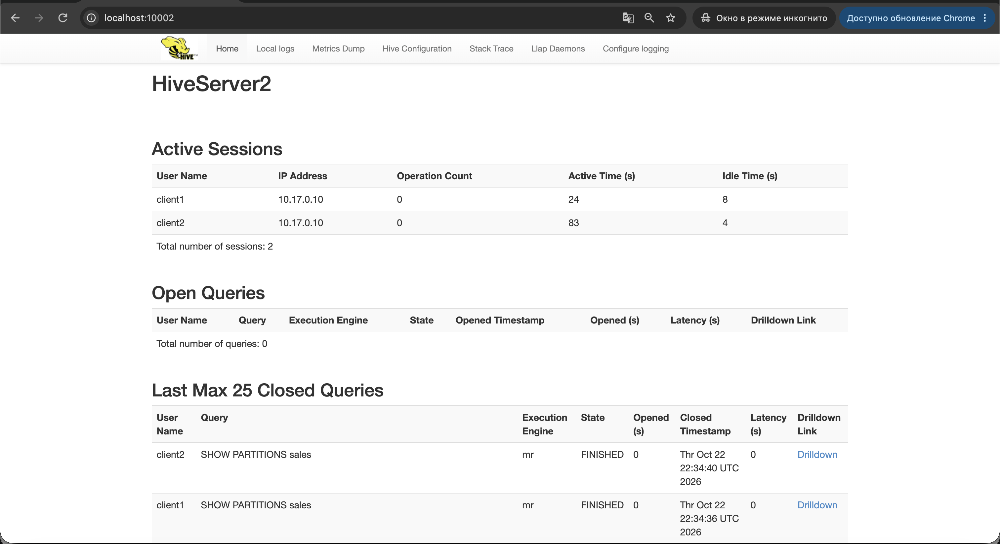
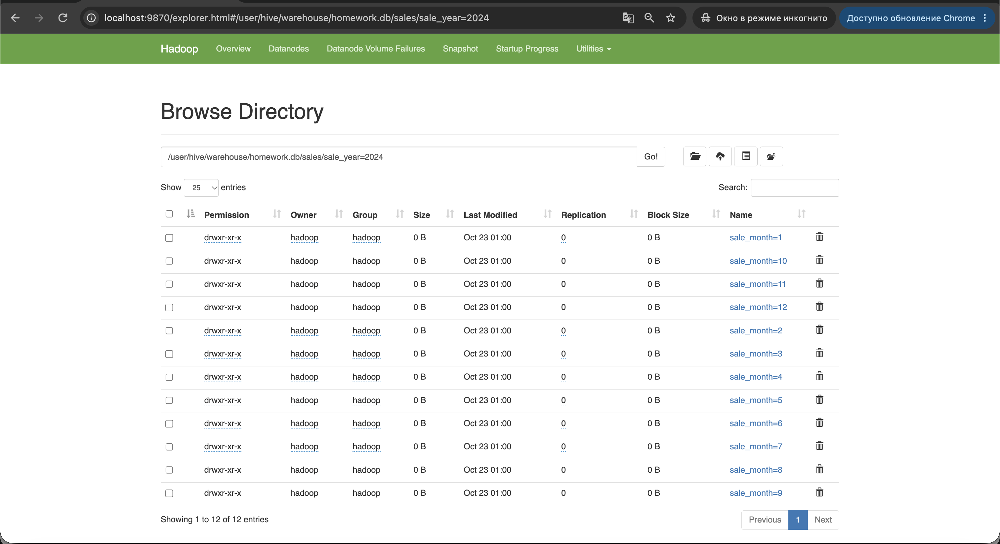
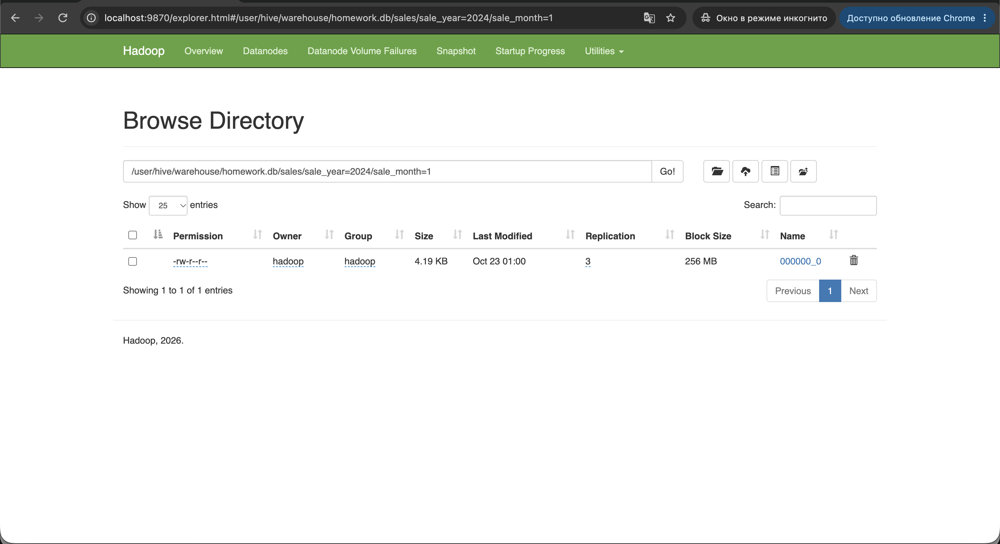

# Apache Hive с удалённым метастором и загрузка в партиционированную таблицу

Hive 4.0.0-alpha-2 поверх HDFS и YARN из `hw-1` и `hw-2`. Hive развёрнут не в embedded-режиме:
метаданные хранятся в PostgreSQL, Hive Metastore работает отдельным сервисом,
а HiveServer2 принимает JDBC-подключения от нескольких клиентов одновременно.
Скрипты запускаются с edge-ноды `team-17-en`.

| Узел | Сервисы |
| --- | --- |
| `team-17-en` | PostgreSQL (база метастора), Hive Metastore `:9083`, HiveServer2 `:10000`, nginx |
| `team-17-nn` | NameNode, DataNode, NodeManager |
| `team-17-00` | Secondary NameNode, DataNode, NodeManager |
| `team-17-01` | ResourceManager, JobHistory Server, DataNode, NodeManager |

Весь кластер работает на OpenJDK 8: Hive 4.0.0-alpha-2 собран под Java 8, Hadoop 3.4.3 её поддерживает.
Хосты, роли, порты и версии задаются в `config/cluster.env`.

## Автоматическое развёртывание

```bash
ssh team@178.236.27.243
git clone https://github.com/<логин>/data_platforms_homework.git
cd data_platforms_homework/hw-3
./deploy.sh
```

`deploy.sh` по очереди запускает:

1. `scripts/00`–`06` — разворачивают HDFS и YARN, как в `hw-2`;
2. `scripts/07-install-hive.sh` — ставит PostgreSQL, создаёт базу и пользователя метастора, скачивает Hive, проверяет SHA-256, устанавливает его и создаёт схему метастора через `schematool`;
3. `scripts/08-start-hive.sh` — запускает Hive Metastore и HiveServer2, закрывает их порты для всех, кроме внутренней сети `10.17.0.0/24`;
4. `scripts/09-publish-web.sh` и `scripts/10-check-yarn.sh` — публикуют веб-интерфейсы, включая HiveServer2, и проверяют YARN, как в `hw-2`;
5. `scripts/11-load-data.sh` — загружает `data/sales.csv` в партиционированную таблицу `homework.sales`;
6. `scripts/12-check-hive.sh` — проверяет Hive и загруженные данные.

Пароль базы метастора генерируется при первом запуске и хранится в `~/.hive-metastore-password` на edge-ноде.

```bash
./scripts/stop-hive.sh          # остановить Hive
./scripts/destroy-cluster.sh    # остановить всё, стереть данные HDFS и базу метастора
```

## Загрузка данных

`data/sales.csv` — 6000 продаж за 2024 год: `order_id, order_date, region, product, quantity, price`.
`scripts/11-load-data.sh` кладёт файл в HDFS (`/user/hadoop/staging/sales`) и выполняет `sql/load_sales.sql`:

1. внешняя таблица `sales_staging` читает CSV из HDFS;
2. таблица `sales` в формате ORC партиционирована по `sale_year` и `sale_month`;
3. `INSERT OVERWRITE ... PARTITION (sale_year, sale_month) SELECT ...` раскладывает строки по партициям динамически; строки без корректной даты, включая заголовок CSV, отбрасываются.

Повторная загрузка перезаписывает партиции, дублей не будет. Другой файл того же формата: `./scripts/11-load-data.sh /путь/к/файлу.csv`.

## Ручное развёртывание

**1. HDFS и YARN** — по `hw-2/README.md`, но с OpenJDK 8: `apt-get install -y openjdk-8-jdk-headless`,
в `hadoop-env.sh` указать `JAVA_HOME=/usr/lib/jvm/java-8-openjdk-amd64`.

**2. PostgreSQL — на `team-17-en`**

```bash
apt-get install -y postgresql libpostgresql-jdbc-java
sudo -u postgres psql -c "CREATE ROLE hive LOGIN PASSWORD '<пароль>'"
sudo -u postgres createdb -O hive metastore
```

**3. Установка Hive — на `team-17-en`**

```bash
curl -fLO https://archive.apache.org/dist/hive/hive-4.0.0-alpha-2/apache-hive-4.0.0-alpha-2-bin.tar.gz
tar -xzf apache-hive-4.0.0-alpha-2-bin.tar.gz -C /opt
cd /opt/apache-hive-4.0.0-alpha-2-bin
rm lib/guava-19.0.jar
cp /opt/hadoop/share/hadoop/common/lib/{guava,failureaccess}-*.jar lib/
ln -s /usr/share/java/postgresql.jar lib/postgresql-jdbc.jar
mkdir -p /var/log/hive
chown -R hadoop:hadoop /opt/apache-hive-4.0.0-alpha-2-bin /var/log/hive
```

**4. Конфигурация** — `conf/hive-site.xml`, шаблон в `config/hive/hive-site.xml`.

| Параметр | Значение |
| --- | --- |
| `javax.jdo.option.ConnectionURL` | `jdbc:postgresql://localhost:5432/metastore` |
| `javax.jdo.option.ConnectionDriverName` | `org.postgresql.Driver` |
| `javax.jdo.option.ConnectionUserName` / `ConnectionPassword` | `hive` / `<пароль>` |
| `hive.metastore.uris` | `thrift://team-17-en:9083` |
| `hive.metastore.thrift.bind.host`, `hive.server2.thrift.bind.host` | `team-17-en` |
| `hive.metastore.warehouse.dir` | `/user/hive/warehouse` |
| `hive.server2.thrift.port` | `10000` |
| `hive.server2.enable.doAs` | `false` |
| `hive.execution.engine` | `mr` |
| `hive.exec.dynamic.partition.mode` | `nonstrict` |

**5. Схема метастора и запуск**

```bash
sudo -u hadoop /opt/hadoop/bin/hdfs dfs -mkdir -p /user/hive/warehouse /tmp/hive
sudo -u hadoop /opt/hadoop/bin/hdfs dfs -chmod 1777 /tmp/hive

cd /opt/apache-hive-4.0.0-alpha-2-bin
sudo -u hadoop bin/schematool -dbType postgres -initSchema
sudo -u hadoop nohup bin/hive --service metastore   > /var/log/hive/metastore.out 2>&1 &
sudo -u hadoop nohup bin/hive --service hiveserver2 > /var/log/hive/hiveserver2.out 2>&1 &
```

**6. Загрузка данных** — из папки `hw-3`

```bash
sudo -u hadoop /opt/hadoop/bin/hdfs dfs -mkdir -p /user/hadoop/staging/sales
sudo -u hadoop /opt/hadoop/bin/hdfs dfs -put -f data/sales.csv /user/hadoop/staging/sales/
sudo -u hadoop /opt/apache-hive-4.0.0-alpha-2-bin/bin/beeline -u jdbc:hive2://team-17-en:10000/default -n hadoop \
  --hivevar db=homework --hivevar staging=/user/hadoop/staging/sales -f sql/load_sales.sql
```

## Проверка

```bash
./scripts/12-check-hive.sh
```

Скрипт проверяет:
- PostgreSQL, Hive Metastore и HiveServer2 запущены;
- схема метастора `4.0.0-alpha-2` лежит в PostgreSQL;
- HiveServer2 работает с удалённым метастором `thrift://team-17-en:9083`;
- порты Hive слушают только внутренний адрес;
- 12 партиций есть и в Hive, и в таблице `PARTITIONS` метастора, и в каталогах HDFS;
- 6000 строк в таблице, по каждой партиции столько же, сколько в CSV;
- 3 клиента одновременно выполняют запросы через HiveServer2.

В конце выводится `ИТОГ: Hive работает, данные загружены в партиционированную таблицу`.

Вручную:

```bash
beeline -u jdbc:hive2://team-17-en:10000/homework -n hadoop -e "SHOW PARTITIONS sales"
beeline -u jdbc:hive2://team-17-en:10000/homework -n hadoop \
  -e "SELECT sale_month, count(*) FROM sales WHERE sale_year = 2024 GROUP BY sale_month"
sudo -u postgres psql -d metastore -c 'SELECT "TBL_NAME", "TBL_TYPE" FROM "TBLS"'
```

## Итоги работы
Несколько клиентов используют систему одновременно:

Партиции в HDFS:

Одна партиция:
