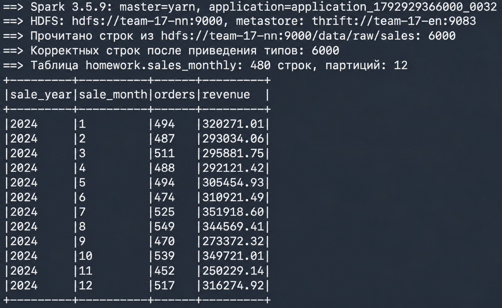
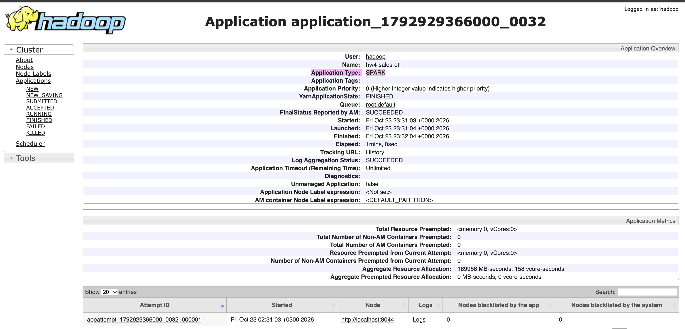
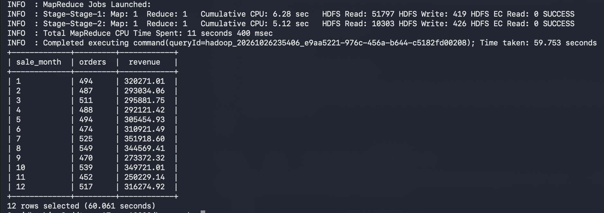

# Apache Spark под управлением YARN: чтение из HDFS, трансформации, запись в таблицу Hive

Spark 3.5.9 работает поверх кластера из `hw-1`–`hw-3`: читает CSV из HDFS, преобразует данные
и сохраняет результат как партиционированную таблицу в общем метасторе Hive, откуда её читает `beeline`.
Скрипты запускаются с edge-ноды `team-17-en`.

| Узел | Сервисы |
| --- | --- |
| `team-17-en` | клиент Spark (драйвер), PostgreSQL, Hive Metastore, HiveServer2, nginx |
| `team-17-nn` | NameNode, DataNode, NodeManager |
| `team-17-00` | Secondary NameNode, DataNode, NodeManager |
| `team-17-01` | ResourceManager, JobHistory Server, DataNode, NodeManager |

Спарковая задача написана на Scala и запускается через `spark-shell`.

## Автоматическое развёртывание

```bash
ssh team@178.236.27.243
git clone https://github.com/lavand0/data_platforms_homework.git
cd data_platforms_homework/hw-4
./deploy.sh
```

`deploy.sh` по очереди запускает:

1. `scripts/00`–`12` — разворачивают HDFS, YARN и Hive, аналогично `hw-3`;
2. `scripts/13-install-spark.sh` — скачивает Spark, проверяет SHA-512, устанавливает его на edge-ноду;
3. `scripts/14-upload-raw.sh` — загружает `data/sales.csv` в HDFS (`/data/raw/sales`);
4. `scripts/15-run-spark-etl.sh` — запускает `spark/sales_etl.scala` в YARN;
5. `scripts/16-check-spark.sh` — проверяет результат через Hive.

Повторный запуск `15-run-spark-etl.sh` пересоздаёт таблицу без дублей

## Задача Spark

`spark/sales_etl.scala`:

1. **Сессия Spark под YARN**: `spark-shell --master yarn`, настройки хранятся в `config/spark/spark-defaults.conf`. 2 исполнителя по 768 МБ.
2. **Подключение к HDFS**: Spark берёт `core-site.xml` из `HADOOP_CONF_DIR`, адрес `hdfs://team-17-nn:9000`. К метастору Hive он подключается через `config/spark/hive-site.xml` (`thrift://team-17-en:9083`).
3. **Чтение**: CSV из `hdfs://team-17-nn:9000/data/raw/sales`.
4. **Трансформации**:
   - приведение типов: `order_id` → `bigint`, `order_date` → `date`, `quantity` → `int`, `price` → `decimal(10,2)`;
   - отбрасывание некорректных строк;
   - вычисляемые колонки `revenue = quantity * price`, `sale_year`, `sale_month`;
   - агрегация по месяцу, региону и товару: `orders`, `units`, `revenue`, `avg_price`.
5. **Партиционирование**: `partitionBy("sale_year", "sale_month")`, по одному ORC-файлу на партицию.
6. **Сохранение как таблицы**: `saveAsTable("homework.sales_monthly")` в формате ORC, совместимом с Hive.
7. **Чтение клиентом Hive**: `beeline` читает `homework.sales_monthly`, подробнее в разделе с проверкой.

Результат: 480 строк (12 месяцев × 5 регионов × 8 товаров) в 12 партициях.

## Ручное выполнение

На edge-ноде, после развёртывания `hw-3`:

**1. Установка Spark**

```bash
curl -fLO https://dlcdn.apache.org/spark/spark-3.5.9/spark-3.5.9-bin-hadoop3.tgz
tar -xzf spark-3.5.9-bin-hadoop3.tgz -C /opt
cd /opt/spark-3.5.9-bin-hadoop3
cp ~/data_platforms_homework/hw-4/config/spark/{spark-defaults.conf,hive-site.xml} conf/
```

```bash
export JAVA_HOME=/usr/lib/jvm/java-8-openjdk-amd64
export HADOOP_CONF_DIR=/opt/hadoop/etc/hadoop
export YARN_CONF_DIR=/opt/hadoop/etc/hadoop
```

```bash
chown -R hadoop:hadoop /opt/spark-3.5.9-bin-hadoop3
sudo -u hadoop /opt/hadoop/bin/hdfs dfs -mkdir -p /spark/jars-3.5.9
sudo -u hadoop /opt/hadoop/bin/hdfs dfs -put /opt/spark-3.5.9-bin-hadoop3/jars/*.jar /spark/jars-3.5.9/
```

**2. Загрузка данных в HDFS** — из папки `hw-4`. Файлы копируются в `/tmp`, потому что пользователю `hadoop` недоступна домашняя папка `team`.

```bash
cp data/sales.csv spark/sales_etl.scala /tmp/ && chmod 644 /tmp/sales.csv /tmp/sales_etl.scala
sudo -u hadoop /opt/hadoop/bin/hdfs dfs -mkdir -p /data/raw/sales
sudo -u hadoop /opt/hadoop/bin/hdfs dfs -put -f /tmp/sales.csv /data/raw/sales/
```

**3. Запуск задачи**

```bash
sudo -u hadoop /opt/spark-3.5.9-bin-hadoop3/bin/spark-shell --master yarn --name hw4-sales-etl \
  --conf spark.hw4.input=hdfs://team-17-nn:9000/data/raw/sales \
  --conf spark.hw4.database=homework --conf spark.hw4.table=sales_monthly \
  -i /tmp/sales_etl.scala < /dev/null
```

В выводе: `master=yarn`, число прочитанных строк, итоговая таблица по месяцам.

## Проверка

```bash
./scripts/16-check-spark.sh
```

Скрипт проверяет:
- библиотеки Spark и исходные данные лежат в HDFS;
- задача `hw4-sales-etl` выполнена в YARN со статусом `SUCCEEDED`;
- таблица `homework.sales_monthly` зарегистрирована в общем метасторе PostgreSQL;
- `beeline` видит её в формате ORC, 12 партиций и 12 каталогов партиций в HDFS;
- через Hive: 480 строк, 6000 заказов и выручка `3703770.06`, ровно как в исходном CSV.

В конце выводится `ИТОГ: Spark на YARN обработал данные из HDFS, Hive читает результат`.

Вручную — стандартным клиентом Hive:

```bash
beeline -u jdbc:hive2://team-17-en:10000/homework -n hadoop -e "SHOW PARTITIONS sales_monthly"
beeline -u jdbc:hive2://team-17-en:10000/homework -n hadoop \
  -e "SELECT sale_month, sum(orders), sum(revenue) FROM sales_monthly WHERE sale_year = 2024 GROUP BY sale_month"
```

Задача Spark видна в ResourceManager: <http://178.236.27.243:8088>, тип `SPARK`.

## Итоги
Отработавшая задача Spark

Она же в YARN

Чтение данных клиентом hive
```
SELECT sale_month, sum(orders) AS orders, sum(revenue) AS revenue FROM sales_monthly WHERE sale_year = 2024 GROUP BY sale_month ORDER BY sale_month;
```

